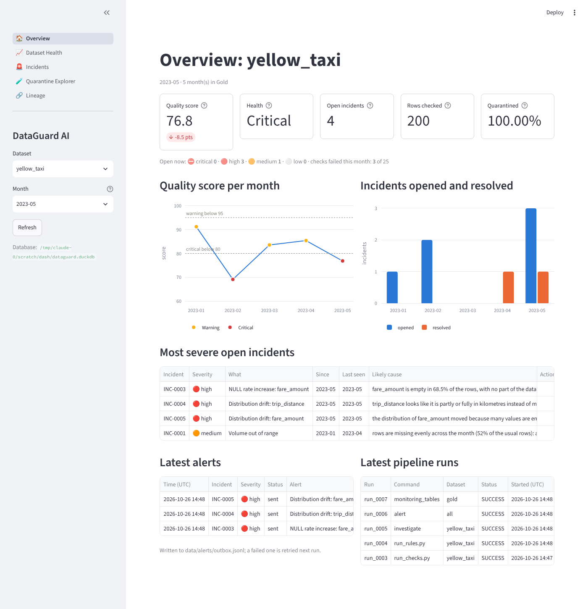
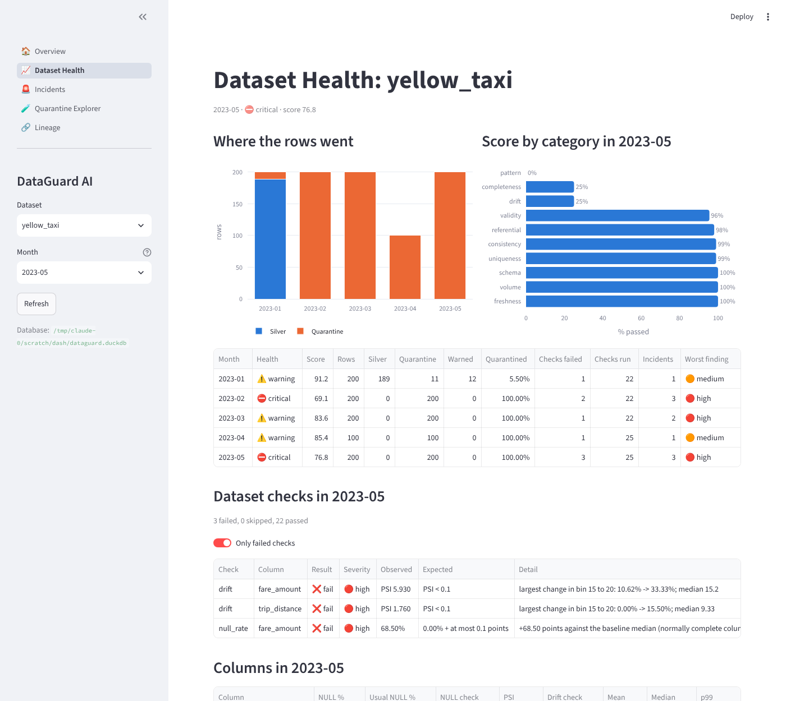
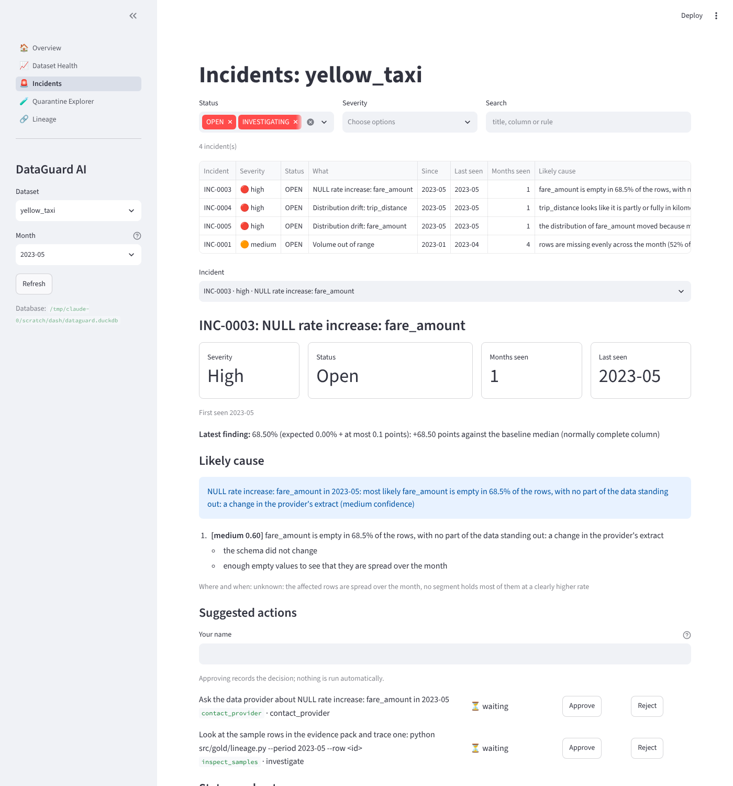
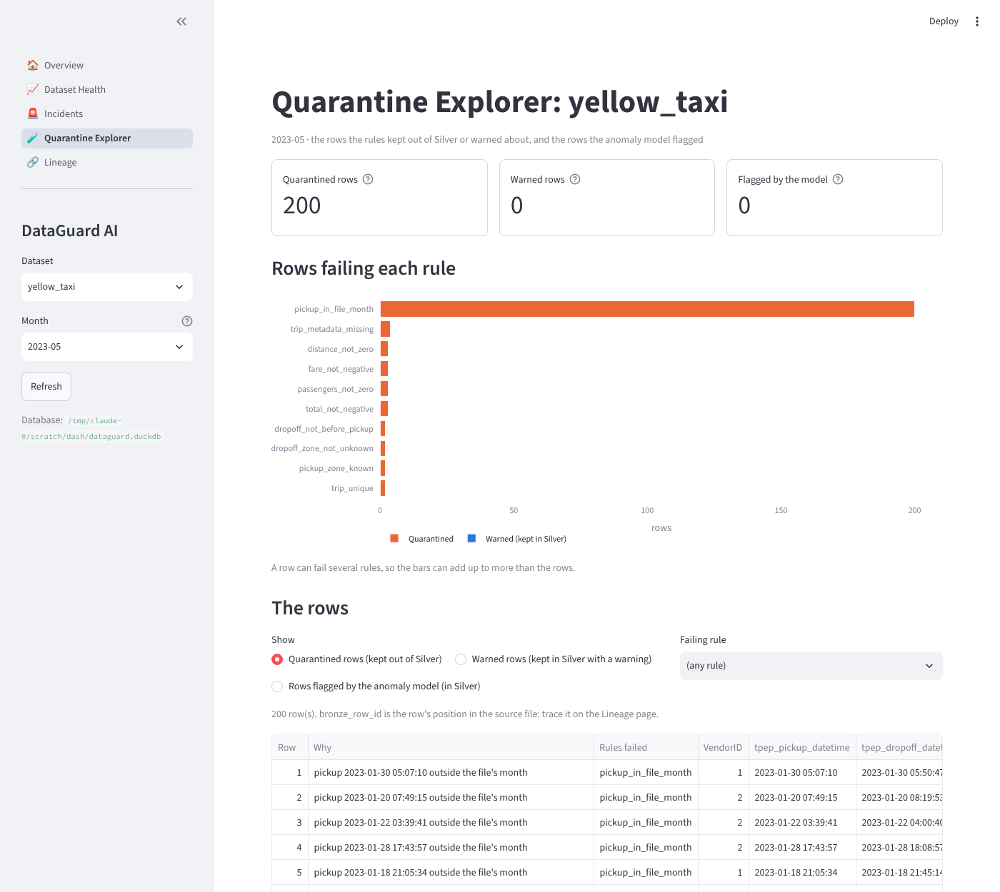
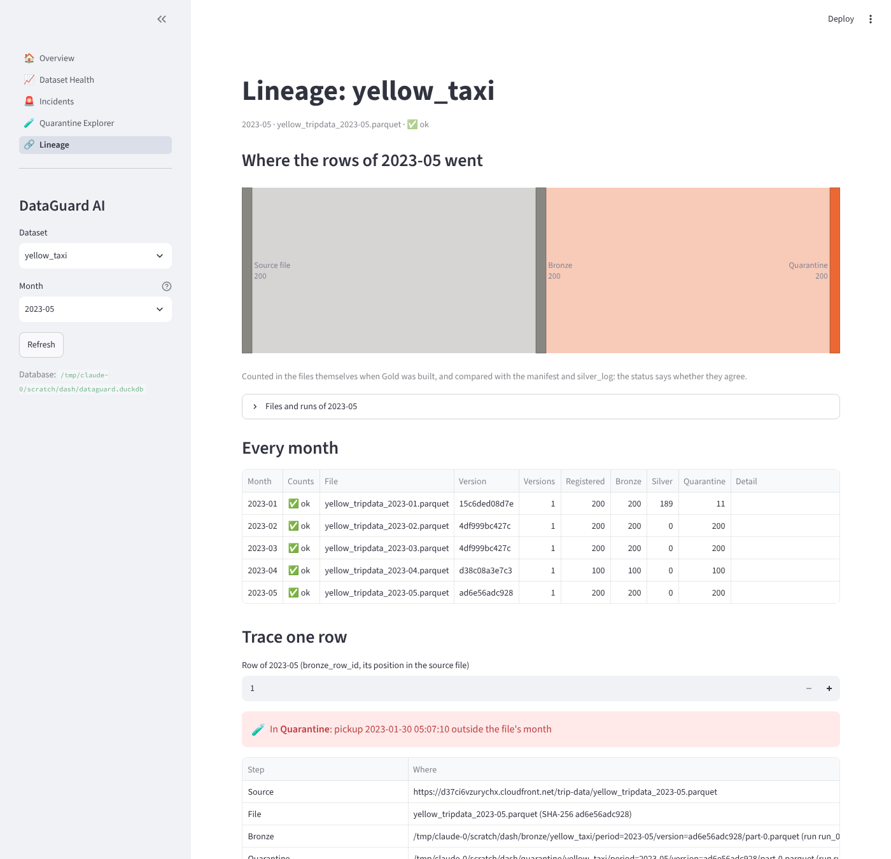

# Dashboard and alerts

Phase 10. A Streamlit app that shows the monitoring results of every dataset (the Gold tables,
the incidents, the alerts, the pipeline runs and the files themselves), and alerts for new
critical and high incidents in a local outbox.

**Done when** a broken file triggers an alert and appears on the dashboard:
`tests/test_phase10_proof.py`, see [Proof](#proof).

```bash
streamlit run src/dashboard/app.py                                    # http://localhost:8501
DATAGUARD_DATABASE=other.duckdb streamlit run src/dashboard/app.py    # another database
```

PowerShell: `$env:DATAGUARD_DATABASE="other.duckdb"; streamlit run src/dashboard/app.py`.



## How it is built

| File | Holds |
|---|---|
| `src/dashboard/app.py` | The entry point: page setup, navigation, sidebar |
| `src/dashboard/data.py` | Every query, as plain functions (no Streamlit), so they are tested without a browser |
| `src/dashboard/actions.py` | The only writes: decisions on the Incidents page |
| `src/dashboard/ui.py` | What every page shares: the chosen dataset and month, cached reads, colors and labels |
| `src/dashboard/views/` | One file per page |

- **Reads are read-only.** Each query opens the DuckDB file read-only and closes it straight
  after. Showing a page never changes the database (`tests/test_dashboard.py` checks the
  file's SHA-256), and it holds DuckDB's file lock only while a query runs, so the pipeline can
  write between two redraws. If a query meets the pipeline's lock, the page says the database
  is busy.
- **The only writes are people's decisions** on the Incidents page: approve, reject or finish
  a suggested action, change an incident's status, add a note. Each opens the database for one
  change through the same code as the command line (`incidents_cli.py`,
  `investigate.py --decide`) and closes it, and each records the person's name. Approving an
  action records the decision; nothing is run.
- **Cached until the file changes.** Reads are cached per database file and the modification
  times of the file and its write-ahead log, and a decision empties the cache: a redraw does not query again, and a rebuild shows on the next redraw. **Refresh** in
  the sidebar empties the cache.
- **Says what to run** when there is nothing to show: no database, Gold not built, no month.

## Pages

| Page | Step | Shows |
|---|---|---|
| Overview | 10.2 | The month at a glance, its trend, open incidents, alerts, runs |
| Dataset Health | 10.3 | Every month of a dataset; the chosen month's checks, columns, score by category; any measure over time; distributions; schema changes |
| Incidents | 10.4 | Every incident with filters; one in depth: finding, likely causes with evidence, where/when, suggested actions to approve or reject, status changes, notes, history |
| Quarantine Explorer | 10.5 | The month's quarantined, warned and model-flagged rows: rows per rule, and the rows themselves with why they failed |
| Lineage | 10.5 | Where the month's rows went, the files and runs, every month's counts and their check, and one row traced from its source file |

### Overview

| Part | What | From |
|---|---|---|
| Headline numbers | Quality score and its change against the month before, health, open incidents, rows checked, share quarantined | `gold_dataset_health`, `gold_incident_summary` |
| Open now | Active incidents by severity, failed checks of the month | `gold_incident_summary`, `gold_dataset_health` |
| Quality score per month | The score, each month's marker colored by its health, the warning and critical limits (`configs/severity_weights.yml`) | `gold_dataset_health` |
| Incidents opened and resolved | Per month, with the incidents active at month end on hover | `gold_incident_monthly` |
| Most severe open incidents | Up to five, by severity then newest, with the likely cause and the actions waiting for approval | `gold_incident_summary`, `gold_investigations` |
| Latest alerts | The dataset's latest alerts and whether they were written | `alert_log` |
| Latest pipeline runs | The last five runs of any dataset | `pipeline_runs` |

### Dataset Health

| Part | What | From |
|---|---|---|
| Where the rows went | Silver and Quarantine rows per month (warned rows on hover) | `gold_dataset_health` |
| Score by category | The month's pass rate per category, lowest first, with its weight and source on hover | `quality_score_parts` |
| Months | Every month: health, score, rows, quarantine share, checks failed, incidents, worst finding | `gold_dataset_health` |
| Dataset checks | Every check of the month's latest check run, failures first (only the failures by default) | `dataset_check_results` |
| Columns | Each column's NULL rate against its usual rate, PSI, mean, median and p99, failures first | `gold_column_profile` |
| One measure over time | Rows per day, quarantine or warned rate, a column's NULL rate or PSI, a rule's failure rate, the model's flag rate or the score; each month's marker shows its check (passed, failed, none) and the dotted line the baseline | `gold_trends` |
| Distribution | Share of the rows per drift bin, the month against the month before, for each binned column (`defaults.drift.bins` in `configs/quality_rules.yml`) | `gold_column_profile` |
| Schema changes | Every column renamed, retyped, missing, added or removed, in any month | `gold_schema_history` |

### Incidents

Read from the incident tables (`incidents`, `incident_events`, `investigations`,
`investigation_actions`), not Gold, so a decision shows at once; the Overview's open incidents
come from the same tables. Gold catches up at the next rebuild.

| Part | What |
|---|---|
| Filters | Status (open and investigating by default), severity, a search in title, column, rule and id |
| List | Every matching incident, most severe and newest first, with its likely cause and actions waiting |
| One incident | Severity, status, months seen, first and last month, the latest finding (observed, expected, detail), a returning problem's earlier incident |
| Likely cause | The investigation's headline and its ranked causes with their evidence, where/when, the report's path |
| Suggested actions | Each action with its decision and who took it: **Approve** or **Reject** while waiting, **Mark done** once approved. Needs your name |
| Status and notes | **Start investigating** (open), **Back to open** (investigating), **Resolve** (either; a resolved incident stays resolved and a recurrence opens a new one), **Add note**; the note text goes with a status change too. Every change is signed "(by name)" in the history |
| History | Every event of the incident, newest first: opened, seen again, clean, investigating, notes, resolved |

### Quarantine Explorer

Reads the month's current Silver and Quarantine files (their paths from `gold_lineage`) and
`ml_anomalies`.

| Part | What |
|---|---|
| Headline numbers | Rows quarantined, rows warned (kept in Silver), rows flagged by the anomaly model |
| Rows failing each rule | Per rule, rows in Quarantine and rows warned in Silver. A row can fail several rules |
| The rows | Quarantined, warned or flagged rows, optionally only those failing one rule: up to 200, with why they failed (the rules' reasons, or the model's score and reasons, most unusual first) and every column; the bookkeeping columns are left out. **Download** saves them as CSV |

### Lineage

| Part | What | From |
|---|---|---|
| Where the rows went | The month's rows from the source file to Bronze, then to Silver (passed or warned) and Quarantine | `gold_lineage`, the Silver file |
| Files and runs | Source URL, file, SHA-256, size, versions registered; the Bronze, Silver and Quarantine files; the runs that wrote and checked them | `gold_lineage` |
| Every month | The counts registered, in Bronze, Silver and Quarantine, and whether they agree (`ok`, `not_processed`, `missing_file`, `mismatch`) | `gold_lineage` |
| Trace one row | A row by its `bronze_row_id` (its position in the source file): where it ended up and why, every step with its file and run, and its values as delivered. The same trace as `python src/gold/lineage.py --period <month> --row <id>` | the control tables and the files |

Health and severity are always shown as a word (with an icon in tables), never by color
alone. Status colors (healthy, warning, critical) are used only for status, never for a series.

## Screenshots

On the five test months of `tests/pipeline_fixture.py` (May 2023 is the broken month).

| Dataset Health | Incidents |
|---|---|
|  |  |

| Quarantine Explorer | Lineage |
|---|---|
|  |  |

## Proof

`tests/test_phase10_proof.py` runs the pipeline as deliveries arrive: January to April are
ingested and rebuilt (alert stage on), then the May file arrives broken (fares empty in 68.5%
of the trips, distances in kilometres) and is ingested and rebuilt the same way.

| Step | Result |
|---|---|
| Rebuild after January to April | 1 alert: the March file holds another month's trips (high, still open). The February schema change was already resolved after two clean months, so it is not alerted |
| Rebuild after the broken May | **3 new alerts**, exactly May's problems: the NULL rate of `fare_amount`, the drift of `trip_distance` ("kilometres instead of miles"), the drift of `fare_amount`; each with its likely cause and the dashboard link. Nothing earlier is alerted again |
| `alert_log` | The 3 May alerts recorded as sent |
| Overview | May comes first in the month picker; health **Critical**; the May incidents among the most severe open ones; the 3 alerts in the alert panel |
| Incidents | The May incidents listed, last seen 2023-05 |
| Dataset Health | May's failed checks: NULL rate and drift |

The pages read the same database the pipeline writes, read-only.

## Tests

`tests/test_dashboard.py` builds the planted pipeline's database (five test months,
investigated, alerted, Gold built) and checks the queries against the Gold tables, the page
itself with Streamlit's `AppTest` (numbers, charts, tables, the month picker), that the file is
unchanged after the page was shown, and the messages when there is no database or no Gold.
For Incidents (on a copy of the database): the list and detail queries, decisions with the
name, status changes and notes, refused changes (a resolved incident, an empty note, no name),
a busy database, and the page's buttons, filters and search. For Quarantine Explorer and
Lineage: the counts per view and rule, the rows with a rule filter and a limit, flagged rows
most unusual first, a month without files, the trace of a quarantined row and of a row that
does not exist, and both pages with their pickers. For Dataset Health: the checks against the month's check run, the trends, the distribution
against the month before and the bin labels, and the page with its toggle and pickers.
